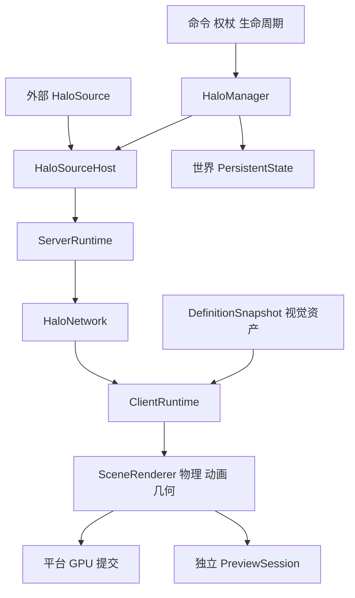

# Halo 仓库与系统地图

审计日期：2026-10-13（Asia/Shanghai）。来源分支：`1.20.1-fabric`；审计文档分支：`review/2026-10-13`。

Halo 基线：`49b822c037606faaf0bb8ba2adba7b63ce0d62bb`；锁定 HaloCore：`a22160a842e15fffb1bc03b5b189183557f6d510`（2.5.0）。所有源码行号指向这两个提交，不指向后续修复版本。

## 审计边界与项目定位

这是 Minecraft 实体头部光环模组，不是同名的 Halo 博客系统。选择默认分支且由 AGENTS.md/DEVELOPMENT.md 指定的维护主线 `1.20.1-fabric`。基线功能版本为 core 2.5.0、adapter.3；联合成品通常为 `2.5.0+adapter.3`，有未提交内容时会加 `.dev`。

完整行为审查及本地检查针对当前主线与其锁定子模块。远端还存在 `1.20.1-forge`、`1.20.1-forge-netease`、`1.21.1-fabric/neoforge`、`26.1/26.2/26.3-fabric/neoforge`，以及 Experimental、caustica、replaymod 和 copilot 工作分支。本次识别了这些分支，未对它们逐支执行兼容验收；不能把主线结论套用为全平台验证。

主仓库生产 Java 为93文件/9172行；core 为116文件/10268行，合计209文件/19440行。测试源文件分别26与31；另有冻结接口/外部调用方 fixtures。统计不含构建产物与依赖源码。阅读采用关键路径逐层追踪及全树检索，重点深入网络、资源解析、存储、运行时状态和渲染；并非每个数学公式都重新做形式化证明。

## 技术栈与依赖

| 层 | 固定配置 / 依赖 | 用途 / 边界 |
| --- | --- | --- |
| 语言 | Java 17、JDK records、泛型及函数式回调 | core 与适配器使用相同语言基线 |
| 游戏 | Minecraft 1.20.1、Yarn 1.20.1+build.10 | MC API 只在适配层；网络与图形库由平台提供 |
| 加载器 | Fabric Loader 0.15.11（编译）、Fabric API 0.92.0+1.20.1 | metadata 允许 Loader>=0.15.0、fabric-api=*；最低组合没有本次实测 |
| 构建 | Gradle wrapper 8.8-all、Loom 1.5.8、Gradle composite includeBuild(core) | 以 gitlink 锁源码，以本地 included build 代替 Maven core 发布包 |
| core 运行依赖 | Gson 2.10、JOML 1.10.5 | 内部解析/数学；最终 JAR 不重复打包 MC 提供的 Gson/JOML |
| 自动测试 | JUnit Jupiter 5.9.2；core launcher 1.9.2 | 假时钟、假存储、帧场景、冻结字节码调用方 |
| 发布工具 | Python标准库，publish.py声明Python3.11+；CI用3.13 | GitHub Release验证、Modrinth/CurseForge intent/receipt |
| 渲染 | OpenGL/LWJGL、MC VertexBuffer/BufferBuilder、JOML、GLSL | core 输出中立几何/命令；平台负责上传、光照和状态恢复 |
| 可选兼容 | EMF>=3.1.1且ABI检测、YSM严格2.6.5、Iris反射桥 | 各自Mixin配置；未在本次实际第三方客户端验收 |

准确依赖声明见 `build.gradle`、`gradle.properties`、`core/build.gradle`、`fabric.mod.json`。不把源代码中的版本常量当作当前第三方最新版，不声称完成了 CVE 数据库扫描。

## 目录与职责

| 路径 | 主要职责 / 阅读入口 |
| --- | --- |
| `AGENTS.md`、`DEVELOPMENT.md` | 双仓库开发/验收约束、维护主线、提交及运行规则 |
| `settings.gradle`、`gradle/core-build.gradle` | 缺子模块时直接失败；来源信息、干净release检查、平铺合包、旧API调用方检查 |
| `src/main/java/.../HaloMod*` | common/client初始化、事件注册、Diagnostics桥接 |
| `command/`、`item/`、`client/` | 权限、命令、权杖目标会话、LOCAL/MULTIPLAYER路由及GUI |
| `json/`、`config/`、`data/`、`lifecycle/` | 资源枚举、文件配置、实体NBT诊断镜像、世界PersistentState、实体恢复 |
| `manager/`、`server/`、`network/`、`platform/` | 服务器权威facade、生命周期、包编码/主线程派发、整合单人桥接 |
| `physics/`、`mixin/`、`compat/` | 头部姿态采集、模型钩子、辅助pass过滤、外部mod ABI与shader桥接 |
| `render/` | 世界/GUI调度、geometry缓存、CPU fallback、GL提交与资源生命周期 |
| `core/.../api/v2/`、`anchor/` | loader中立来源/锚点API，world与preview的作用域和仲裁 |
| `core/.../core/runtime/` | ServerRuntime、HaloSourceHost、ClientRuntime、DefinitionResources、LocalOwnership、PreviewPort |
| `core/.../render/`、`physics/`、`animation/`、`shape/` | 帧采样、阻尼/动画、图元/OBJ几何、透明三角排序、保留scene输出 |
| `src/main/resources/assets/halo/` | client定义、模型/纹理、shader、语言及anchor资源 |
| `src/main/resources/data/halo/` | 配方及服务器anchor；内置光环定义主要位于assets |
| `src/test/`、`core/src/test/`、`src/testFixtures/`、`core/src/testFixtures/` | 平台适配测试、core行为/数学、冻结兼容接口及外部provider |
| `.github/workflows/`、`scripts/release/`、`.github/release-targets.json` | Java CI、发布器测试、可信主线发布实现、多平台allowlist |
| `docs/`、`COMPAT_TEST_PLAN.md` | API、资源定义、mesh/preview契约、历史人工与性能验收记录 |

上表省略Java共同前缀 `network/azusake/halo`。

## 权威状态与依赖关系



`HaloManager`的ServerRuntime facade在本版本由 HaloSourceHost 进行来源仲裁；world_data 的持久候选由 manager 显式写入PersistentState，不是将客户端视觉map写回存档。

| 路径 | 实际调用链与契约 |
| --- | --- |
| show/hide | 权限/目标检查 → manager存取世界候选 → HaloSource来源仲裁 → ServerRuntime选择 → Updates编码attach/remove → client线程修改ClientRuntime |
| 玩家加入 | ServerPlayConnectionEvents.JOIN → 单个全量快照 + 空hello → client replace + MULTIPLAYER阶段 |
| 资源加载 | Fabric ResourceManager → UTF-8 ResourceInput → DefinitionResources按source优先级发布 → VisualAssetLoader → CPU/GPU缓存 → client tick reconciliation |
| 世界帧 | AFTER_ENTITIES入口 → 采集实体/相机/anchor/light事实 → renderFrame → body pose/appearance → legacy或cached primitive + mesh → 合适shader阶段提交 |
| GUI预览 | InventoryScreen重定向 → PreviewAnchorScope捕获 → view专属PreviewSession → 同一FrameOutput/GPU适配器；不推进世界appearance第二次 |
| LOCAL | 无hello服务端 → 本地仅自己的佩戴 → 按socket地址文本key保存 → 每帧restoreInto当前client replica |
| 生命周期 | 死亡、卸载、重生、跨维度按实体身份处理；暂时不可见不等于撤销所有权，显式hide才播shutdown |

资源优先级：服务端data source为0，客户端resources为1；同JVM中的发布通过synchronized/volatile快照交接。只同步definition ID，不同步每个客户端的JSON/模型/纹理；缺定义保留佩戴并在资源恢复后继续渲染。这是文档化设计，不作为数据不一致缺陷。`/halo config`是会话调试配置，只桥接整合单人客户端，专用服不持久化/分发，同样是明确设计。

NBT有两层：`halo_world_data`的Halos列表是权威world_data所有权；`HaloInstance`实体NBT由HaloEntityData维护诊断镜像，不能据此恢复权威状态。外部来源候选由各来源在登录/新server session重新提交，不能假定world_data已保存外部状态。

## 线程与资源所有权

| 状态 / 资源 | 拥有方 | 保护 / 释放 |
| --- | --- | --- |
| ServerRuntime/HaloSourceHost/来源候选 | logical server thread | Host检查owner thread；stop关闭host并清状态 |
| ClientRuntime/PreviewSession | client owner thread | 网络解码后client.execute；world token/reset失效预览 |
| DefinitionCatalog/DefinitionResources | loading source → immutable snapshot | synchronized publish + volatile snapshot；潜在内部数组例外见HALO-009 |
| world锚点 | frame/entity scope | ThreadLocal作用域 + synchronized coordinator；上一帧样本最多保留一帧 |
| GPU VBO/EBO | render thread | generation与mesh identity；更新时close已移除条目，失败memoize |
| 上传staging内存 | MeshUploadBuffer lexical scope | AutoCloseable，先摘除BufferBuilder storage再free，防第三方重复释放 |
| 图像/OBJ流 | resource loading stage | try-with-resources关闭；OBJ有字节/geometry预算，定义/ring预算缺口见007/008 |
| CPU视觉缓存 | VisualAssetLoader代际 | 完整client reload重建；同代际资产移除保留见011 |

类引用存在 `HaloMod → HaloServerEvents/HaloJsonLoader → HaloManager/HaloNetwork → HaloMod` 等注册/日志回边，renderer与资源loader也互相调用。它们是可确认的源码耦合，不等于已发现类初始化死锁或运行时循环。core对平台的依赖边界已通过bytecode和resolved dependency检查；不建议因为类名/风格偏好而拆分核心算法。

## 构建、运行与发布

```sh
git clone --branch 1.20.1-fabric --recurse-submodules https://github.com/AzusaKe/Halo.git
cd Halo
./core/gradlew -p core build --console=plain
./gradlew build --console=plain
python3 -m unittest discover -s scripts/release -p 'test_*.py' -v
```

联合JAR将core classes平铺进Halo JAR，避免第三方API被嵌套JAR隐藏；check依赖core check、verifyDistribution和verifyLegacyAnchorApi。sourcesJar附带core源码。release模式要求Halo/core干净、gitlink等于core HEAD，并实际从core origin获取固定SHA。只有带v*标签的CI才创建Release，普通分支不应产生外部分发。

| 启动task | 独立运行目录 |
| --- | --- |
| runClient / runClient2 | run / run2 |
| runServer | runServer/1.20.1-fabric |
| runSmokeServer | .local/smoke-server |
| runSmokeClient / runSmokeClient2 | .local/smoke-client / .local/smoke-client2 |

本次没有启动这些游戏task，也没有接受EULA、创建世界或修改外部服务。发布工具已阅读并仅运行mock单元测试：可信默认分支代码验证tag run、commit/core provenance、Release body hash、主安装JAR/可选sources，再用Release asset intent/receipt协调重试。没有实际dispatch、上传、删除asset或修改平台metadata。

本次实际运行状态见[verification-baseline.md](verification-baseline.md)，风险与修复优先级见[findings.md](findings.md)。
